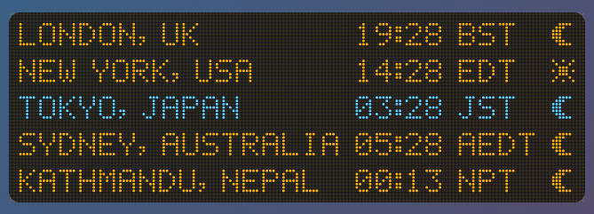
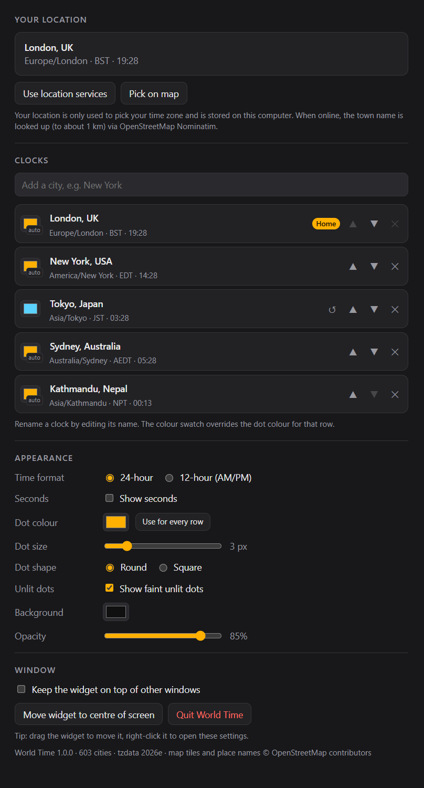

# Dot Clock

A lightweight world clock for Windows and macOS. It sits on your desktop as a small dot-matrix display, one line per city.

## What it does

- **One line per location.** Each line shows the city, its local time, the time-zone abbreviation (BST, GMT, EDT, JST…) and a sun or moon for day or night.
- **Finds where you are.** Location services set your home city. If they're turned off, just search for your city (or the nearest one) instead.
- **Any number of cities.** Search to add them, then rename or reorder them.
- **12-hour or 24-hour time,** with optional seconds.
- **Make it look how you like.**
  - The background can be any colour, from solid to fully transparent.
  - Dots can share one colour, or each line can have its own.
  - Dot size and shape can be changed too.
- **Stays out of the way.** The widget has no window frame. Drag it anywhere, keep it on top if you like, and it remembers where you left it.

## How it works

- **Small download.** The app is built with [Tauri](https://tauri.app): a small Rust program around the web view already in your system (WebView2 on Windows, WebKit on macOS). That keeps the installer to a few megabytes.
- **The display** is drawn dot by dot from a 5×7 dot-matrix font.
- **Times and daylight saving** come from your computer's own time-zone database, so clock changes happen automatically.
- **Day or night** is worked out from where the sun actually is at each city, not a fixed 6am–6pm rule.
- **City search works offline,** from a built-in list of about 600 cities that covers every time zone.
- **No internet needed.** The app never connects to anything. Your settings are saved to a small file on your computer.

## Screenshots

## Building it yourself

See [BUILDING.md](BUILDING.md) for how to make the Windows `.msi` and macOS `.dmg` installers.

## Check out the Singular Widgets

[Dot Calendar](https://github.com/slainbya-dotcom/dot-Calendar)
[Dot Clipboard](https://github.com/slainbya-dotcom/dot-clipboard)
[Dot Clock](https://github.com/slainbya-dotcom/dot-clock)
[Dot Deck](https://github.com/slainbya-dotcom/dot-deck)
[Dot Dice](https://github.com/slainbya-dotcom/dot-dice)
[Dot Focus](https://github.com/slainbya-dotcom/dot-focus)
[Dot Launcher](https://github.com/slainbya-dotcom/dot-launcher)
[Dot List](https://github.com/slainbya-dotcom/dot-list)
[Dot Planner](https://github.com/slainbya-dotcom/dot-planner)
[Dot Player](https://github.com/slainbya-dotcom/dot-player)
[Dot Reader](https://github.com/slainbya-dotcom/dot-reader)
[Dot Sun](https://github.com/slainbya-dotcom/dot-sun)
[Dot System](https://github.com/slainbya-dotcom/dot-system)
[Dot Ticker](https://github.com/slainbya-dotcom/dot-ticker)
[Dot Timer](https://github.com/slainbya-dotcom/dot-timer)
[Dot Visualiser](https://github.com/slainbya-dotcom/dot-visualiser)
[Dot Weather](https://github.com/slainbya-dotcom/dot-weather)